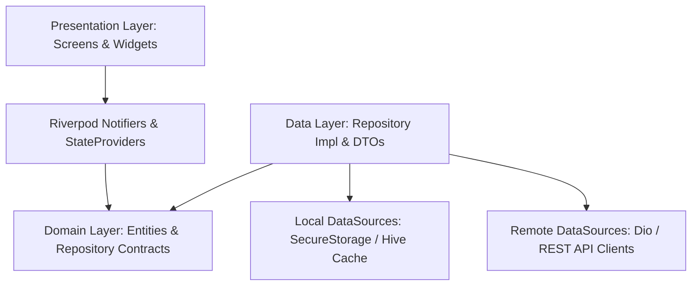
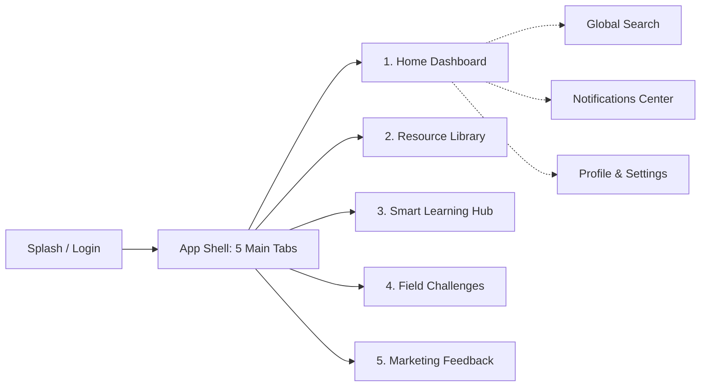
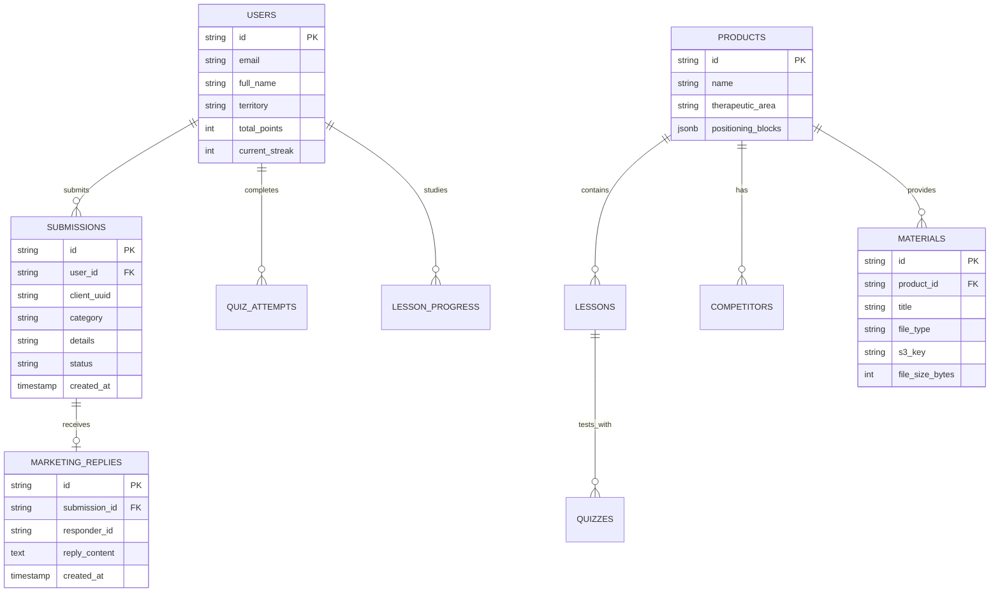

# 🩺 RxEdge — الدليل الشامل للهندسة المعمارية والربط البرمجي (Backend & Architecture Guide)

> **الهدف من هذا الدليل:**
> هذا المستند موجّه لك ولفريق الـ **Backend Developer** لفهم وظائف التطبيق بالكامل، فلسفة العمل الميداني، تدفق البيانات (Data Flow)، العقود البرمجية للـ APIs (Endpoints & JSON Payloads)، واستراتيجية العمل دون إنترنت (Offline-First).

---

## 📑 جدول المحتويات
1. [ما هو تطبيق RxEdge وفلسفته التصميمية](#1-ما-هو-تطبيق-rxedge-وفلسفته-التصميمية)
2. [الهندسة المعمارية للتطبيق (Clean Architecture)](#2-الهندسة-المعمارية-للتطبيق-clean-architecture)
3. [الشاشات والأقسام الخمسة الرئيسية وتدفق المستخدم (User Flows)](#3-الشاشات-والأقسام-الخمسة-الرئيسية-وتدفق-المستخدم)
4. [مواصفات وعقود الـ Backend APIs (Endpoints & Payloads)](#4-مواصفات-وعقود-الـ-backend-apis)
5. [استراتيجية العمل دون اتصال (Offline-First & Data Sync)](#5-استراتيجية-العمل-دون-اتصال)
6. [مخطط الكيانات وقاعدة البيانات المقترحة (Database Entities)](#6-مخطط-الكيانات-وقاعدة-البيانات-المقترحة)

---

## 1. ما هو تطبيق RxEdge وفلسفته التصميمية

### 🎯 الغرض الأساسي (Core Purpose)
**RxEdge** هو تطبيق محمول فائق الأداء والاحترافية مخصص لـ **مندوبي الدعاية الطبية (Medical Representatives)** في شركات الأدوية.
- المندوب يقضي معظم وقته داخل العيادات والمراكز والمستشفيات، حيث تكون تغطية الشبكة غالباً ضعيفة أو منعدمة.
- يحتاج المندوب لمراجعة سريعة (خلال 30 إلى 60 ثانية قبل دخول غرفة الطبيب) حول: رسائل المنتج الأساسية، الرد العلمي على ادعاءات المنافسين، وعرض المواد العلمية والـ E-Detailing.
- يحتاج التطبيق لربط المندوب مباشرة بفريق التسويق (Marketing Team / Brand Managers) لنقل نبض السوق، اعتراضات الأطباء، والمطالبات التسويقية للمنافسين بشكل فوري.

### 🎨 القواعد التصميمية الصارمة (Design Principles)
1. **تصميم مسطح وهادئ تماماً (Strictly Flat Material 3):**
   - لا توجد تدرجات لونية (No gradients)، لا توجد أشكال زجاجية (No glassmorphism)، ولا مؤثرات توهج نيونية.
   - خطوط واضحة، حدود دقيقة `1px hairline border` بدرجة رمادية هادئة، وخلفيات مريحة للعين في الإضاءة المختلفة.
2. **استخدام مقيد للون الكهرماني الذهبي (`#D9930D` Amber Accent):**
   - مخصص فقط للمكافآت، النقاط، خطوط الاستمرارية (Streaks)، والشارات (Badges). لا يُستخدم في أزرار عادية لمنع الطابع الطفولي للـ Gamification.
3. **زر أساسي واحد فقط لكل شاشة (Single Primary Button Rule):**
   - لا تتنافس الأزرار في بصر المندوب؛ دائماً يوجد إجراء أساسي وحيد وواضح (Filled Primary CTA) وأي إجراءات أخرى تكون ثانوية (Outlined أو Text Buttons).
4. **دعم كامل للغتين العربية والإنجليزية مع اتجاه RTL سليم.**

---

## 2. الهندسة المعمارية للتطبيق (Clean Architecture)

التطبيق مبني وفق نموذج **Clean Architecture + Riverpod 2.6** الصارم:



- **Domain Layer:** نقي تماماً بدون أي مكتبات خارجية؛ يحتوي على الكيانات (`Entities`) وتعريفات الواجهات (`Repository Interfaces`).
- **Data Layer:** يحتوي على الـ `DTOs`، عمليات التحويل من وإلى JSON، التخزين المحلي، والاتصال بالخادم.
- **Presentation Layer:** يحتوي على الشاشات، عناصر التحكم، إدارة الحالة بـ Riverpod، ودعم التوطين والسمات.

---

## 3. الشاشات والأقسام الخمسة الرئيسية وتدفق المستخدم



### 1️⃣ التبويب الأول: لوحة المعلومات (Home Dashboard)
- **الهيدر العلوي:** صورة المندوب واسمه، ونقطة تنبيه حية ترتبط بعدد الإشعارات غير المقروءة عند النقر عليها تفتح `NotificationsScreen`.
- **بطاقة التحفيز السريع:** أيام الاستمرارية الميدانية (Streak)، المنطقة الجغرافية (Territory)، والنقاط المجمعة.
- **إجراء رئيسي واحد (Primary CTA):** بطاقة `ContinueLearningCard` تعرض آخر درس توقف عنده المندوب بنسبة إنجازه مع زر "متابعة التعلم".
- **اعتراض الشهر (Objection Quote Card):** بطاقة سريعة تعرض اقتباساً من أكثر الاعتراضات شيوعاً مع زر فتح الرد العلمي السريع.
- **المواد السريرية الشائعة (Trending Materials):** استعراض أفقي للمطويات والبروشورات الأكثر استخداماً.
- **ملخص التحديات (Leaderboard Preview):** عرض ترتيب المندوب والمراكز الثلاثة الأولى.
- **إحصائيات سريعة:** عدد الملفات المحملة أوفلاين، الدروس المكتملة، والردود التسويقية المستلمة.

---

### 2️⃣ التبويب الثاني: المكتبة العلمية (Resource Library)
- **كتالوج المواد الميدانية:** يشمل ملفات PDF، صور عالية الدقة (High-res mechanism of action)، وعروض تقديمية تفاعلية للزيارات (E-Detailing slides).
- **أدوات التصفية والبحث:**
  - تبديل طريقة العرض (شبكة كروت Grid أو قائمة رأسية List).
  - رقائق تصنيف تفاعلية (Filter Chips): حسب الدواء (Product)، وحسب نوع الملف (PDF, Image, E-Detailer)، وحسب حالة التنزيل (Downloaded).
- **الاستعراض السريري المدمج (Dedicated Viewers):**
  - **PDF Viewer:** يدعم التنقل بين الصفحات، عرض مصغرات الصفحات (Page Thumbnails)، ومؤشر تقدم.
  - **Image Viewer:** تكبير وتصغير عالي الدقة بدون أي تشويش.
  - **E-Detailer:** عرض تقديمي تفاعلي مخصص للمقابلة مع الطبيب يدعم التنقل بالشريحة وشاشة ملء العرض.
- **التخزين دون اتصال (Offline Storage):** تنزيل بنقرة واحدة، مؤشر تنزيل مع إمكانية مسح الملفات لتوفير مساحة التخزين.

---

### 3️⃣ التبويب الثالث: مركز التعلم الذكي (Smart Learning Hub)
- **بطاقات المنتجات:** اسم المنتج، الفئة العلاجية (Therapeutic Area)، ومؤشر حلقي أنيق `ProgressRing` يوضح عدد الدروس المكتملة (مثلاً: `3/8 Lessons`). تظهر المنتجات الجاري دراستها والموصى بها في المقدمة.
- **صفحة تفاصيل المنتج (Product Detailing Page):** تحتوي على تبويبين واضحين:
  1. **التموضع التسويقي (Product Positioning):**
     - مقسم إلى كتل معلوماتية مقتضبة قابلة للمسح السريع بالعين (Scannable Blocks): الرسالة الأساسية (Key Message)، الأطباء المستهدفون (Target Doctors)، الفوائد الرئيسية (Key Benefits)، جرعة الاستخدام (Dosage Highlights)، ونقاط الإثبات السريرية (Proof Points). يمنع استخدام نصوص طويلة مكدسة.
  2. **التعامل مع المنافسين (Competitive Handling):**
     - قائمة بالأدوية المنافسة في السوق.
     - عند فتح أي منافس يظهر كرت مقارنة بـ 3 أجزاء واضحة:
       - **ادعاء المنافس (Their claim):** ما يقوله مندوب المنافس للطبيب.
       - **طريقة الرد العلمي (How to respond):** الرد المقنع بالحقائق المعتمدة.
       - **الدليل السريري المعتمد (Proof / Reference):** اسم الدراسة ورقم الصفحة والمجلة.
       - **زر إجراء:** "نسخ نقطة الحوار" (`Copy talking point`) بنقرة واحدة.
- **شاشة قراءة الدرس السريري (Clinical Lesson Reader):**
  - شريط إنجاز علوي رفيع، نص منظم، زر حفظ في الإشارات المرجعية (Bookmarks)، زر أساسي في النهاية "تحديد كمكتمل" (`Mark as complete`)، يليه زر التحدي "خوض الاختبار السريع" (`Take quick quiz`).

---

### 4️⃣ التبويب الرابع: التحديات الميدانية والتحفيز المهني (Field Challenges)
- مبني بفلسفة **التحفيز المهني الهادئ (Professional Gamification)** بدون عناصر صبيانية:
- يحتوي على مقسم تحكم ثلاثي الأقسام (Segmented Control):
  1. **التحدي الشهري (Monthly Challenge):**
     - عنوان التحدي، عداد تنازلي للموعد النهائي، قواعد المسابقة في 3 أسطر بحد أقصى، مؤشر تقدم المندوب، وقائمة المتصدرين (Top 10 Leaderboard) مع تثبيت صف خاص يعرض ترتيب المندوب الحالي ونقاطه في الأسفل.
  2. **الاختبارات السريعة (Quick Quizzes):**
     - تجربة الاختبار: سؤال واحد في كل شاشة، شريط تقدم علوي، خيارات إجابة عريضة بارتفاع مريح للمس، تقييم فوري باللون الأخضر أو الأحمر مع شرح علمي بسطر واحد، ثم الانتقال للسؤال التالي.
     - شاشة النتيجة: عرض النتيجة، النقاط المكتسبة، الوقت المستغرق، وثلاثة إجراءات: مراجعة الإجابات الخاطئة، إعادة المحاولة، أو العودة للمنتج.
  3. **اعتراض الشهر (Objection of the Month):**
     - الخطوة الأولى: تعرض اعتراض الطبيب الصعب مع زر "فكر أولاً" (Think First).
     - الخطوة الثانية: كشف الرد الموصى به من فريق التسويق.
     - إجراء تفاعلي: تقييم "هل كان هذا مفيداً؟" ونموذج "شارك ردك الميداني" لرفعه للمراجعة.
  4. **سجل المسابقات (History):** أرشيف بالمسابقات السابقة ونتائج الاختبارات التي خاضها المندوب.

---

### 5️⃣ التبويب الخامس: التغذية الراجعة التسويقية الحية (Marketing Feedback)
- الغرض: إعطاء المندوب قناة مباشرة ومحترمة لنقل ما يحدث في العيادات فوراً لمدراء التسويق.
- **3 بطاقات رئيسية لأنواع التقارير:**
  1. **اعتراض طبيب (Doctor Objection):** دواء الشركة، نص الاعتراض، تخصص الطبيب (اختياري)، وكيف قمت بالرد عليه (اختياري).
  2. **ادعاء منافس (Competitor Claim):** اسم المنافس، ادعاؤه، أين سمعت به، وصورة للمنشور أو الروشتة (اختياري).
  3. **ملاحظات ميدانية (Field Feedback):** الموضوع، التفاصيل، ومرفق صورة أو تسجيل صوتي (اختياري).
- **ميزات الإرسال:**
  - نموذج متدرج (Progressive Disclosure): الحقول الاختيارية تظهر تدريجياً لعدم إرباك المندوب.
  - حفظ تلقائي للمسودة (Autosaved Draft) واستعادتها بهدوء مع رسالة صغيرة "تمت استعادة المسودة".
  - طابور إرسال دون اتصال (Offline Queue): في حال عدم وجود إنترنت، يُحفظ التقرير كـ `Pending` ويُرسل تلقائياً بمجرد عودة الاتصال.
  - قائمة تقاريري (`My submissions`): تعرض حالة كل تقرير بـ StatusBadge واضح (`Pending` -> `Sent` -> `Seen by marketing` -> `Answered`)، مع إمكانية فتح التقرير وقراءة رد فريق التسويق المعتمد.

---

### 6️⃣ الوحدات المساندة (System & Core Modules)
1. **الملف الشخصي والإعدادات (Profile & Settings):**
   - بيانات المندوب (الاسم، المنطقة، الإيميل)، رصيد النقاط، وسام الإنجازات (Badges).
   - مفتاح فوري لتبديل اللغة (عربي / إنجليزي).
   - مفتاح تبديل السمة (System / Light / Dark).
   - تفضيلات التنبيهات (Material alerts, Challenge reminders, Feedback replies).
   - إدارة التخزين والتنزيلات مع عرض الحجم المستهلك وزر تفريغ التخزين المؤقت.
   - معلومات سياسة الأمان وتغيير كلمة المرور وتواصل مع التسويق.
   - تسجيل الخروج مع حوار تأكيدي.
2. **مركز الإشعارات (Notifications Center):**
   - 4 أنواع رئيسية: `new_material`, `new_challenge`, `feedback_reply`, `quiz_reminder`.
   - تمييز الإشعار غير المقروء بخلفية هادئة ونقطة لونية.
   - زر "تحديد الكل كمقروء" (Mark all as read).
   - النقر على الإشعار يوجه المندوب مباشرة للشاشة المعنية (Deep-linking).
3. **البحث الشامل (Global Search):**
   - يبحث في آن واحد عبر: الدروس العلمية، ملفات المكتبة، واعتراضات الأطباء.
   - سجل عمليات البحث الأخيرة مع إمكانية حذف بحث معين أو مسح السجل بالكامل.
   - تصنيف النتائج ضمن مجموعات أنيقة (Lessons / Library / Objections).
4. **مرشد الاستخدام الأول (Coach Marks) وشريط الاتصال (Connectivity Banner):**
   - 3 شرائح تعريفية خفيفة وقابلة للتخطي تظهر لمرة واحدة فقط عند أول فتح للتطبيق.
   - شريط إنترنت ذكي: يظهر بأعلى الشاشة عند انقطاع الشبكة بدون تعطيل عمل المندوب، ويظهر تأكيد أخضر هادئ لمدة ثانيتين فور عودة الاتصال.

---

## 4. مواصفات وعقود الـ Backend APIs

على مطور الـ Backend بناء الـ Endpoints التالية وفق معايير RESTful JSON القياسية:

### 🔑 المصادقة والتوثيق (Authentication)

#### 1. تسجيل الدخول (Login)
- **المسار:** `POST /api/v1/auth/login`
- **الطلب (Request):**
```json
{
  "email": "alex.morgan@pharma.com",
  "password": "Password123!"
}
```
- **الاستجابة الناجحة (200 OK):**
```json
{
  "success": true,
  "data": {
    "token": "eyJhbGciOiJIUzI1NiIsInR5cCI6IkpXVCJ9...",
    "refreshToken": "d7a8f9c0-...",
    "user": {
      "id": "usr_101",
      "name": "Alex Morgan",
      "email": "alex.morgan@pharma.com",
      "role": "Senior Medical Representative",
      "territory": "North Delta & Alexandria",
      "points": 1420,
      "streakDays": 12,
      "avatarUrl": "https://cdn.pharma.com/avatars/usr_101.png"
    }
  }
}
```

#### 2. تجديد التوكن (Refresh Token)
- **المسار:** `POST /api/v1/auth/refresh`
- **الطلب:** `{"refreshToken": "d7a8f9c0-..."}`
- **الاستجابة:** `{"token": "new_jwt_here..."}`

---

### 📊 لوحة التحكم (Home Dashboard)

- **المسار:** `GET /api/v1/dashboard/home`
- **الترويسة (Headers):** `Authorization: Bearer <token>`
- **الاستجابة الناجحة (200 OK):**
```json
{
  "success": true,
  "data": {
    "streakDays": 12,
    "currentPoints": 1420,
    "monthlyTargetPoints": 2000,
    "territory": "North Delta & Alexandria",
    "continueLearning": {
      "lessonId": "les_cardura_02",
      "productId": "prod_cardura",
      "productName": "Cardura XL",
      "lessonTitle": "Dosing & Titration Protocols in Hypertensive BPH",
      "completedCount": 2,
      "totalCount": 5
    },
    "objectionOfTheMonth": {
      "id": "obj_2026_11",
      "productName": "Cardura XL",
      "doctorQuote": "Tamsulosin works faster and has fewer vascular effects.",
      "recommendedResponse": "Cardura XL provides 24-hour dual control for both dynamic and static urinary obstruction while reducing blood pressure variability."
    },
    "trendingMaterials": [
      {
        "id": "mat_01",
        "title": "Cardura XL Clinical Monograph 2026",
        "fileType": "pdf",
        "fileSize": "4.2 MB",
        "downloadUrl": "https://cdn.pharma.com/docs/cardura_mono.pdf"
      }
    ],
    "leaderboardRank": 4,
    "leaderboardTotal": 85
  }
}
```

---

### 📚 المكتبة العلمية (Resource Library)

#### 1. جلب قائمة المواد
- **المسار:** `GET /api/v1/library/materials?product={id}&type={pdf|image|edetail}&search={q}`
- **الاستجابة (200 OK):**
```json
{
  "success": true,
  "data": [
    {
      "id": "mat_101",
      "title": "Dual Mechanism Clinical Study",
      "productId": "prod_cardura",
      "productName": "Cardura XL",
      "type": "pdf",
      "fileSize": 3450000,
      "pageCount": 12,
      "downloadUrl": "https://s3.amazonaws.com/pharma-assets/mat_101.pdf",
      "thumbnailUrl": "https://s3.amazonaws.com/pharma-assets/mat_101_thumb.png",
      "updatedAt": "2026-10-15T08:00:00Z"
    }
  ]
}
```

---

### 💡 مركز التعلم الذكي (Smart Learning Hub)

#### 1. قائمة المنتجات
- **المسار:** `GET /api/v1/learn/products`
- **الاستجابة:**
```json
{
  "success": true,
  "data": [
    {
      "id": "prod_cardura",
      "name": "Cardura XL",
      "therapeuticArea": "Urology & Cardiology",
      "totalLessons": 5,
      "completedLessons": 2,
      "positioning": {
        "keyMessage": "The once-daily GITS dual controller for BPH and concomitant hypertension.",
        "targetDoctors": ["Urologists", "Cardiologists", "General Practitioners"],
        "keyBenefits": [
          "True 24-hour steady plasma levels without peaks or troughs.",
          "Dual action on both smooth muscle relaxation and symptom relief."
        ],
        "dosageHighlights": "Initial: 4mg once daily with breakfast. Max: 8mg once daily.",
        "proofPoints": [
          "PREDICT Study: 43% reduction in acute urinary retention.",
          "Clinical Trial Hub 2025: Superior tolerability over standard alpha-blockers."
        ]
      },
      "competitors": [
        {
          "id": "comp_omnic",
          "name": "Omnic Ocas (Tamsulosin)",
          "claim": "Higher uroselectivity with zero cardiovascular interference.",
          "response": "Cardura XL's GITS formulation prevents blood pressure drops in normotensives while treating comorbid hypertension effectively.",
          "reference": "European Urology Review 2024; Vol 48, p. 112-119."
        }
      ]
    }
  ]
}
```

#### 2. جلب درس معين
- **المسار:** `GET /api/v1/learn/lessons/{lessonId}`
- **الاستجابة:**
```json
{
  "success": true,
  "data": {
    "id": "les_cardura_02",
    "productId": "prod_cardura",
    "title": "Dosing & Titration Protocols in Hypertensive BPH",
    "contentMarkdown": "# Titration Guidelines\n\nAlways ensure the patient takes...",
    "estimatedReadMinutes": 4,
    "isCompleted": false,
    "isBookmarked": true,
    "quizId": "quiz_cardura_02"
  }
}
```

#### 3. تسجيل إتمام الدرس
- **المسار:** `POST /api/v1/learn/lessons/{lessonId}/complete`
- **الاستجابة:** `{"success": true, "pointsAwarded": 25, "newTotalPoints": 1445}`

---

### 🏆 التحديات والاختبارات (Challenges & Quizzes)

#### 1. بيانات التحدي الشهري والمتصدرين
- **المسار:** `GET /api/v1/challenges/monthly`
- **الاستجابة:**
```json
{
  "success": true,
  "data": {
    "id": "chal_2026_11",
    "title": "November Detailing Mastery",
    "deadline": "2026-11-30T23:59:59Z",
    "rules": [
      "Complete all 4 product refreshers before Nov 20.",
      "Achieve >= 80% on the weekly BPH objection quiz.",
      "Submit at least 2 verified competitor claims."
    ],
    "userProgress": {
      "completedSteps": 3,
      "totalSteps": 5,
      "myRank": 4,
      "myPoints": 620
    },
    "leaderboard": [
      {"rank": 1, "name": "Sarah Jenkins", "territory": "Cairo East", "points": 890, "avatarUrl": "..."},
      {"rank": 2, "name": "Karim Adel", "territory": "Giza South", "points": 820, "avatarUrl": "..."},
      {"rank": 3, "name": "Omar Farouk", "territory": "Mansoura", "points": 750, "avatarUrl": "..."}
    ]
  }
}
```

#### 2. جلب بنك أسئلة اختبار سريع
- **المسار:** `GET /api/v1/quizzes/{quizId}`
- **الاستجابة:**
```json
{
  "success": true,
  "data": {
    "id": "quiz_cardura_02",
    "title": "Cardura XL Clinical Quick Quiz",
    "timeLimitSeconds": 180,
    "questions": [
      {
        "id": "q1",
        "question": "What is the primary pharmacological benefit of the GITS delivery system?",
        "options": [
          "Immediate drug release within 15 minutes",
          "Constant zero-order release maintaining steady 24-hr plasma levels",
          "Direct absorption through the oral mucosa",
          "Elimination of all hepatic metabolism"
        ],
        "correctIndex": 1,
        "explanation": "GITS osmotic mechanism releases doxazosin at a constant rate, eliminating peak-to-trough fluctuations."
      }
    ]
  }
}
```

#### 3. إرسال نتيجة الاختبار
- **المسار:** `POST /api/v1/quizzes/{quizId}/submit`
- **الطلب:**
```json
{
  "score": 4,
  "totalQuestions": 5,
  "durationSeconds": 68,
  "answers": [
    {"questionId": "q1", "selectedIndex": 1}
  ]
}
```
- **الاستجابة:** `{"success": true, "pointsEarned": 50, "streakUpdated": true}`

---

### 📢 التغذية الراجعة الميدانية (Marketing Feedback)

#### 1. إرسال تقرير فيدباك جديد
- **المسار:** `POST /api/v1/feedback/submissions`
- **الترويسة:** `Content-Type: multipart/form-data` (أو `application/json` إذا تم رفع الصور مسبقاً)
- **الحقول (Payload):**
```json
{
  "clientSubmissionId": "uuid-v4-locally-generated",
  "category": "doctor_objection",
  "productId": "prod_cardura",
  "title": "Safety in elderly normotensive patients",
  "doctorSpecialty": "Urology",
  "details": "Dr. Mahmoud at Alexandria Clinic raised concerns about orthostatic hypotension in patients over 70.",
  "repResponse": "Clarified that GITS technology releases medicine osmotically over 24h, significantly reducing postural drops.",
  "attachmentUrl": null
}
```
- **الاستجابة (201 Created):**
```json
{
  "success": true,
  "data": {
    "id": "fb_9021",
    "status": "sent",
    "createdAt": "2026-11-09T14:25:00Z"
  }
}
```

#### 2. جلب تقارير المندوب وتحديثات الردود
- **المسار:** `GET /api/v1/feedback/my-submissions`
- **الاستجابة:**
```json
{
  "success": true,
  "data": [
    {
      "id": "fb_9021",
      "category": "doctor_objection",
      "productName": "Cardura XL",
      "title": "Safety in elderly normotensive patients",
      "status": "answered",
      "createdAt": "2026-11-07T11:00:00Z",
      "marketingReply": {
        "responderName": "Dr. Tarek (Product Manager)",
        "replyText": "Great response Alex! We have added an updated geriatric safety slide to the E-Detailer in your Library today.",
        "repliedAt": "2026-11-08T15:30:00Z"
      }
    }
  ]
}
```

---

### 🔔 مركز الإشعارات (Notifications)

- **جلب الإشعارات:** `GET /api/v1/notifications`
- **تحديد الكل كمقروء:** `POST /api/v1/notifications/mark-all-read`
- **تحديد إشعار واحد كمقروء:** `PATCH /api/v1/notifications/{id}/read`

---

## 5. استراتيجية العمل دون اتصال (Offline-First)

نظرًا لطبيعة عمل المندوب داخل العيادات ذات التغطية الضعيفة:

1. **التعامل مع انقطاع الشبكة:**
   - جميع شاشات التطبيق تستهلك البيانات المخزنة محلياً في الـ Cache تلقائياً.
   - لا يظهر للمندوب أي شاشة خطأ مانعة (No blocking errors)؛ بدلاً من ذلك يظهر شريط `ConnectivityBanner` غير حاجب.
2. **طابور إرسال التقارير (Sync Queue):**
   - عند إرسال فيدباك ميداني دون إنترنت، ينشئ التطبيق `clientSubmissionId` محلياً (UUID v4) ويخزن الكائن في التخزين الآمن بحالة `Pending`.
   - فور عودة اتصال الإنترنت، يقوم الـ `FeedbackLocalDatasource` بعمل `background batch upload` وإرسال التقارير وتحديث حالتها إلى `Sent`.
   - استخدام الـ `clientSubmissionId` كـ `Idempotency-Key` يضمن عدم تكرار التقرير في قاعدة البيانات إذا حدث انقطاع أثناء الإرسال.
3. **تنزيل المواد السريرية (Resource Downloads):**
   - يتم حفظ ملفات الـ PDF والـ E-Detailing في مجلد التطبيق المخصص (`getApplicationDocumentsDirectory`).
   - يدعم التطبيق التحقق من التجزئة (Hash/ETag) لمعرفة ما إذا كانت المادة تم تحديثها على السيرفر لتنزيل النسخة الأحدث فقط.

---

## 6. مخطط الكيانات وقاعدة البيانات المقترحة



---

## 🛠️ معلومات التشغيل للمطورين

- **Flutter SDK:** `3.38.5` (Dart `3.10.4`).
- **حزمة إدارة الحالة:** `flutter_riverpod: ^2.6.1`.
- **التوجيه (Routing):** `go_router: ^17.5.0` بنظام `StatefulShellRoute` للحفاظ على حالة التبويبات الخمسة.
- **التخزين المشفر المحلي:** `flutter_secure_storage` و `shared_preferences`.
- **الأيقونات:** `lucide_icons`.
- **التوطين:** `intl` مع ملفات `app_en.arb` و `app_ar.arb` مجهزة بالكامل.
