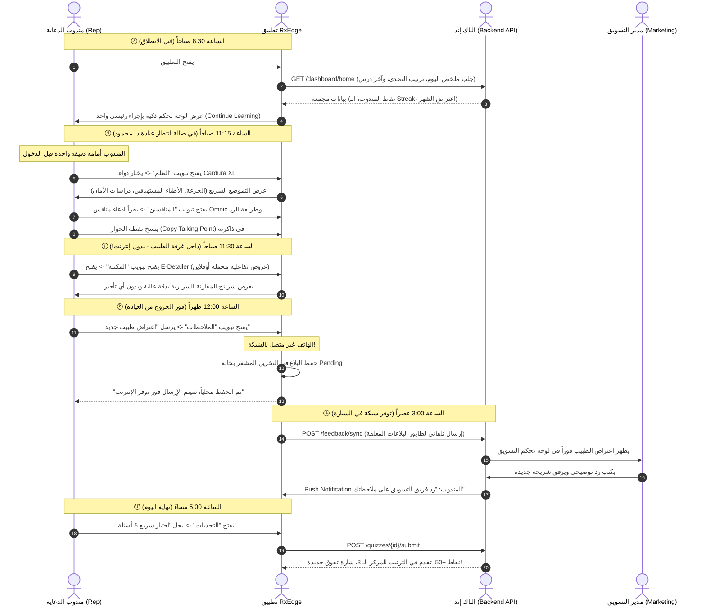
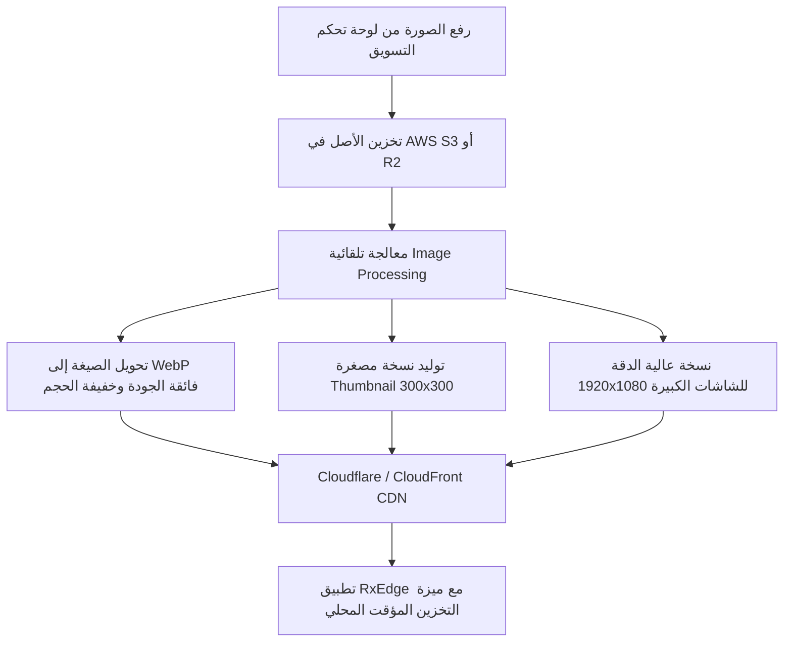

# 🩺 RxEdge — المرجع الشامل لمطور الباك إند (Master Backend & Product Specification)

> **إلى زميلنا مطور الباك إند (Backend Developer):**  
> هذا الملف كُتب خصيصاً لك ليكون دليلك الشامل خطوة بخطوة لبناء نظام متكامل (APIs، قواعد بيانات، تخزين ملفات، وإدارة وسائط وصور) يخدم تطبيق **RxEdge**.  
> التطبيق مبني بالكامل على Flutter بنموذج **Clean Architecture** ويدعم العمل **دون إنترنت (Offline-First)**.

---

## 📑 الفهرس العام
1. [فلسفة التطبيق وسيناريو يوم المندوب الميداني (The Real User Journey)](#1-فلسفة-التطبيق-وسيناريو-يوم-المندوب-الميداني)
2. [دليل دورات العمل خطوة بخطوة (Cycle-by-Cycle Specifications)](#2-دليل-دورات-العمل-خطوة-بخطوة)
   - [السايكل 1: التوثيق والحسابات وصلاحيات المناطق (Auth & Sessions)](#السايكل-1-التوثيق-والحسابات-وصلاحيات-المناطق)
   - [السايكل 2: لوحة التحكم اليومية المجمعة (Home Dashboard Daily Brief)](#السايكل-2-لوحة-التحكم-اليومية-المجمعة)
   - [السايكل 3: مركز التعلم الذكي وتموضع الأدوية (Learn Hub & Product Detailing)](#السايكل-3-مركز-التعلم-الذكي-وتموضع-الأدوية)
   - [السايكل 4: التعامل مع المنافسين واعتراضات الأطباء (Competitive Handling & Objections)](#السايكل-4-التعامل-مع-المنافسين-واعتراضات-الأطباء)
   - [السايكل 5: منظومة الصور والوسائط والمكتبة السريرية (Images, Media & CDN Pipeline)](#السايكل-5-منظومة-الصور-والوسائط-والمكتبة-السريرية)
   - [السايكل 6: التحديات والاختبارات السريعة ولوحة الشرف (Gamification & Quizzes)](#السايكل-6-التحديات-والاختبارات-السريعة-ولوحة-الشرف)
   - [السايكل 7: الفيدباك الميداني والمزامنة دون اتصال (Marketing Feedback & Offline Queue)](#السايكل-7-الفيدباك-الميداني-والمزامنة-دون-اتصال)
   - [السايكل 8: مركز الإشعارات والتوجيه العميق (Notifications & Deep Linking)](#السايكل-8-مركز-الإشعارات-والتوجيه-العميق)
3. [استراتيجية العمل دون إنترنت والتخزين المؤقت (Offline-First Architecture)](#3-استراتيجية-العمل-دون-إنترنت-والتخزين-المؤقت)
4. [مخطط قاعدة البيانات المقترح (PostgreSQL / Relational DB Schema)](#4-مخطط-قاعدة-البيانات-المقترح)
5. [المواصفات البرمجية الدقيقة للـ REST APIs (Endpoints, Headers, Payloads)](#5-المواصفات-البرمجية-الدقيقة-للـ-rest-apis)

---

## 1. فلسفة التطبيق وسيناريو يوم المندوب الميداني

### من هو مستخدم التطبيق؟
المستخدم هو **مندوب الدعاية الطبية (Medical Representative / MR)** في شركة أدوية، ومعه في المقابل **مدير المنتج / فريق التسويق (Brand / Product Manager)** في المقر الرئيسي.

### 🕒 السيناريو اليومي الواقعي (A Day in the Life of a Rep):


---

## 2. دليل دورات العمل خطوة بخطوة

---

### السايكل 1: التوثيق والحسابات وصلاحيات المناطق
- **مفهوم العمل:** حسابات المندوبين لا تنشأ عبر تسجيل حر مفتوح (No Public Sign-up)، بل يتم تزويدها وتجهيزها مركزياً من إدارة الشركة (Enterprise Provisioned).
- **وظيفة الباك إند:**
  1. التحقق من البريد الإلكتروني وكلمة المرور.
  2. إرجاع `JWT Access Token` (صلاحيته مثلاً 24 ساعة) مع `Refresh Token` طويل الأمد.
  3. ربط كل مندوب بـ:
     - منطقته الجغرافية (`territory`: مثل "الإسكندرية والبحيرة").
     - قائمة الأدوية المسندة لخط عمله (`assigned_products`).
     - رصيده من النقاط والـ Streak الميداني.
  4. في حال نسيان كلمة المرور: واجهة التطبيق توجه المندوب للتواصل مع إدارة التسويق/IT وليس إعادة تعيين تلقائية عشوائية.

---

### السايكل 2: لوحة التحكم اليومية المجمعة (Home Dashboard)
- **مفهوم العمل:** في شاشات الموبايل الميدانية، يمنع إرسال 6 أو 7 طلبات HTTP منفصلة لشاشة واحدة؛ لأن ذلك يستنزف البطارية ويفشل إذا كانت الشبكة بطيئة.
- **وظيفة الباك إند:**
  توفير **Endpoint واحدة مجمعة** اسمها `GET /api/v1/dashboard/home` تجمع في استجابة واحدة:
  1. بطاقة التحفيز السريع: رصيد النقاط، أيام الاستمرارية الميدانية (`streakDays`).
  2. الدرس المقترح استكماله (`continueLesson`): آخر درس لم يكمله المندوب مع نسبة التقدم.
  3. اعتراض الشهر الموصى به (`objectionOfTheMonth`): يختاره مدير التسويق كل شهر كأبرز اعتراض يواجه الشركة في السوق.
  4. التحدي الشهري السريع (`challenge`): عنوان المسابقة وعدد الأيام المتبقية وترتيب المندوب الحالي.
  5. المواد السريرية الرائجة (`recentMaterials`): أحدث بروشورات أو دراسات تم رفعها حديثاً.

---

### السايكل 3: مركز التعلم الذكي وتموضع الأدوية (Learn Hub)
- **مفهوم العمل:** المندوب لا يقرأ كتباً في العيادة، بل يحتاج إلى معلومات مركزة ومختصرة بنظام **Scannable Blocks**.
- **وظيفة الباك إند:**
  توفير هيكل بيانات لكل دواء يحتوي على جزأين:
  1. **التموضع التسويقي (Product Positioning):**
     - الرسالة الأساسية (`keyMessage`): جملة واحدة تميز الدواء عن كل أدوية السوق.
     - الأطباء المستهدفين (`targetDoctors`): قائمة التخصصات (مثل: استشاري مسالك بولية، أطباء قلب).
     - الفوائد الرئيسية (`keyBenefits`): نقاط موجزة بنقاط واضحة.
     - إرشادات الجرعات (`dosageHighlights`): الجرعة البدائية والجرعة القصوى والوقت الأفضل للتناول.
     - الأدلة السريرية (`proofPoints`): أسماء الدراسات العالمية المعتمدة ونسبة الفعالية.
  2. **الدروس السريرية (Clinical Lessons):**
     - قائمة الدروس المرتبطة بكل دواء مع تتبع حالة المندوب (`completed`, `bookmarked`).
     - عند إنهاء المندوب للدرس، يستدعي التطبيق `POST /learn/lessons/{id}/complete` ليقوم السيرفر بزيادة نقاط المندوب وتحديث مؤشر التقدم الدائري (`ProgressRing`).

---

### السايكل 4: التعامل مع المنافسين واعتراضات الأطباء
- **مفهوم العمل:** أكثر نقطة حساسة في زيارة الطبيب هي عندما يقول الطبيب: *"أنا أصف دواء الشركة المنافسة لأنه أرخص/أسرع/أكثر أماناً"*.
- **وظيفة الباك إند:**
  توفير جدول للمنافسين مرتبط بكل دواء، بحيث يحتوي كل منافس على:
  - اسم الدواء المنافس والمادة الفعالة.
  - ادعاء المنافس (`theirClaim`): ما يقوله مندوب المنافس للطبيب.
  - الرد الموصى به من تسويق الشركة (`recommendedResponse`): رد علمي هادئ ومقنع.
  - المرجع الطبي (`clinicalReference`): اسم الدورية العلمية ورقم الصفحة والسنة لدعم الموقف.

---

### السايكل 5: منظومة الصور والوسائط والمكتبة السريرية 🖼️
> 💡 **هذه النقطة في غاية الأهمية بناءً على رغبتك في جعل مظهر التطبيق فائق الجمال والاحترافية!**

التطبيق الطبي يبدو باهتاً إذا كانت الصور رديئة أو غير مهندمة. يحتاج مطور الباك إند إلى تطبيق خط إنتاج وسائط محترف (**Media Pipeline**):



#### 📐 مواصفات ومعايير الصور التي يجب على الباك إند تجهيزها:
| نوع الصورة | الغرض منها في التطبيق | الأبعاد الموصى بها | الصيغة | متطلبات المعالجة |
| :--- | :--- | :--- | :--- | :--- |
| **علبة الدواء (Product Packshot)** | تظهر في كروت المنتجات وقائمة الأدوية | `600x600` بكسل | `WebP` أو `PNG` شفاف | تفريغ خلفية احترافي شفاف بدون حواف بيضاء |
| **مخطط آلية العمل (Mechanism of Action - MoA)** | رسومات طبية توضح تأثير الدواء على الخلايا | `1200x800` بكسل | `WebP` / `SVG` | ألوان واضحة عالية الدقة تدعم التكبير (Pinch-to-zoom) |
| **شرائح العرض التفاعلي (E-Detailing Slides)** | شاشات عرض يقدمها المندوب للطبيب أثناء الزيارة | `1920x1080` (16:9) | `WebP` عالي الجودة | نصوص مقروءة بوضوح حتى على الهواتف الصغيرة |
| **ملفات الـ PDF والأبحاث** | أوراق الأبحاث والدراسات المعتمدة | ملفات PDF حقيقية | `application/pdf` | توفير `thumbnailUrl` للصفحة الأولى من البحث |
| **أفاتار وشارات التحديات** | صور المندوبين وشارات الإنجازات | `256x256` بكسل | `WebP` دائرية | شارات ذهبية كهرمانية (`#D9930D`) بدقة حادة |

#### 🚀 نصائح تقنية للباك إند للصور:
1. **استخدام CDN مع روابط دائمة:** إرجاع الروابط من نطاق سريع مثل `https://cdn.rxedge.com/products/cardura_box.webp`.
2. **رؤوس التخزين المؤقت (Cache-Control Headers):**
   ```http
   Cache-Control: public, max-age=31536000, immutable
   ```
   هذا يجعل الموبايل يحمل الصورة مرة واحدة فقط ولا يعيد طلبها أبداً طالما لم يتغير اسمها!
3. **توفير حقلين للصورة دائماً في الـ JSON:**
   ```json
   {
     "imageUrl": "https://cdn.rxedge.com/materials/cardura_study_full.webp",
     "thumbnailUrl": "https://cdn.rxedge.com/materials/cardura_study_thumb.webp"
   }
   ```
   حيث يُعرض الـ `thumbnailUrl` فوراً أثناء تصفح القوائم لتفادي أي بطء، وعند نقر المندوب يتم فتح الصورة بالدقة الكاملة.

---

### السايكل 6: التحديات والاختبارات السريعة (Gamification)
- **مفهوم العمل:** تحفيز تنافسي شريف بين مندوبي المناطق بدون استخدام أشكال طفولية أو مهرجانات Confetti.
- **وظيفة الباك إند:**
  1. **التحدي الشهري (Monthly Challenge):**
     - مسابقة شهرية محددة بوقت وتاريخ انتهاء.
     - تتبع إنجاز المندوب لكل شرط من شروط المسابقة.
     - توليد **لوحة المتصدرين (Leaderboard):** أفضل 10 مندوبين + صف ثابت يعرض ترتيب المندوب الحالي ونقاطه بدقة.
  2. **بنك أسئلة الاختبارات السريعة (Quick Quizzes):**
     - كل درس يرتبط باختبار سريع (مثلاً 3 إلى 5 أسئلة).
     - كل سؤال يحتوي على: نص السؤال، 4 خيارات، فهرس الإجابة الصحيحة، و**شرح علمي توضيحي بسطر واحد** يظهر فور إجابة المندوب.
  3. **حساب النقاط ومكافحة التلاعب:**
     - منع تكرار الحصول على نقاط نفس الاختبار أكثر من مرة.
     - زيادة عداد الـ Streak اليومي إذا قام المندوب بحل اختبار واحد على الأقل يومياً.

---

### السايكل 7: الفيدباك الميداني والمزامنة دون اتصال (Marketing Feedback)
- **مفهوم العمل:** نقل نبض الشارع والعيادات لمدراء المنتجات في المقر الرئيسي.
- **أنواع البلاغات الثلاثة:**
  1. **اعتراض طبيب (Doctor Objection):** دواء الشركة، نص الاعتراض، تخصص الطبيب، وكيف رد المندوب.
  2. **ادعاء منافس (Competitor Claim):** اسم المنافس، ادعاؤه، أين سُمع، وصورة البروشور أو الروشتة.
  3. **ملاحظات ميدانية (Field Feedback):** موضوع عام، تفاصيل، وصورة أو تسجيل صوتي.
- **دورة حياة حالة البلاغ (Status Lifecycle):**
  ```text
  Pending (بالهاتف أوفلاين) 
     ⬇ (توفر اتصال ومزامنة)
  Sent (وصل لسيرفر الباك إند)
     ⬇ (فتحه مدير التسويق)
  Seen by Marketing (تمت الرؤية)
     ⬇ (كتب مدير التسويق رداً رسمياً)
  Answered (تم الرد - ويظهر رد التسويق للمندوب داخل التطبيق)
  ```
- **منع التكرار (Idempotency):** يقوم التطبيق بتوليد `clientSubmissionId` محلياً (UUID v4) وإرساله مع الطلب. إذا انقطع الاتصال وأعاد الهاتف الإرسال، يعرف السيرفر أن هذا الطلب تم استلامه مسبقاً فلا ينشئ سجلاً مكرراً.

---

### السايكل 8: مركز الإشعارات والتوجيه العميق (Notifications)
- **مفهوم العمل:** تنبيه المندوب بالأحداث الهامة مع نقطة حمراء صغيرة على أيقونة الجرس في الشاشة الرئيسية.
- **أنواع الإشعارات الأساسية:**
  - `new_material`: تم نشر مادة علمية جديدة في المكتبة.
  - `feedback_reply`: رد فريق التسويق على اعتراض أو ملاحظة أرسلها المندوب.
  - `new_challenge`: انطلاق تحدي أسبوعي أو شهري جديد.
  - `quiz_reminder`: تذكير بالاختبار اليومي للحفاظ على الـ Streak.
- **التوجيه العميق (Deep Linking):** كل إشعار يحمل في بياناته `targetScreen` و `targetId` لكي يؤدي الضغط عليه إلى فتح الشاشة المطلوبة مباشرة.

---

## 3. استراتيجية العمل دون إنترنت والتخزين المؤقت

بما أن المندوب يدخل مستشفيات وعيادات تنعدم فيها الشبكة تماماً:
1. **عدم تعطيل الشاشات (No Blocking Errors):**
   - عندما ينقطع الإنترنت، لا تظهر للمندوب شاشة بيضاء أو رسالة خطأ مزعجة.
   - يعرض التطبيق البيانات المحفوظة محلياً، مع ظهور شريط علوي خفيف وهادئ `ConnectivityBanner` ينبهه بالعمل دون اتصال.
2. **الـ ETags للتحديث الذكي للمواد والمكتبة:**
   - السيرفر يرسل ترويسة `ETag` مع كل مادة أو درس.
   - عندما يطلب التطبيق التحديث، يرسل `If-None-Match: "<etag>"`.
   - إذا لم يتغير المحتوى، يرجع السيرفر `304 Not Modified` فوراً لتوفير الباقة والوقت.

---

## 4. مخطط قاعدة البيانات المقترح

```sql
-- 1. جدول المستخدمين (المندوبين)
CREATE TABLE users (
    id UUID PRIMARY KEY DEFAULT gen_random_uuid(),
    employee_code VARCHAR(50) UNIQUE NOT NULL,
    full_name VARCHAR(150) NOT NULL,
    email VARCHAR(150) UNIQUE NOT NULL,
    password_hash VARCHAR(255) NOT NULL,
    territory VARCHAR(100) NOT NULL,
    role VARCHAR(50) DEFAULT 'medical_rep',
    avatar_url TEXT,
    total_points INT DEFAULT 0,
    current_streak INT DEFAULT 0,
    created_at TIMESTAMP WITH TIME ZONE DEFAULT NOW()
);

-- 2. جدول المنتجات والأدوية
CREATE TABLE products (
    id UUID PRIMARY KEY DEFAULT gen_random_uuid(),
    name VARCHAR(100) NOT NULL,
    brand_code VARCHAR(50) UNIQUE NOT NULL,
    therapeutic_area VARCHAR(100) NOT NULL,
    box_image_url TEXT NOT NULL,
    positioning_blocks JSONB NOT NULL, -- Key message, target doctors, proof points
    is_active BOOLEAN DEFAULT TRUE,
    created_at TIMESTAMP WITH TIME ZONE DEFAULT NOW()
);

-- 3. جدول المنافسين
CREATE TABLE competitors (
    id UUID PRIMARY KEY DEFAULT gen_random_uuid(),
    product_id UUID REFERENCES products(id) ON DELETE CASCADE,
    competitor_name VARCHAR(100) NOT NULL,
    active_ingredient VARCHAR(100),
    their_claim TEXT NOT NULL,
    recommended_response TEXT NOT NULL,
    clinical_reference TEXT NOT NULL,
    created_at TIMESTAMP WITH TIME ZONE DEFAULT NOW()
);

-- 4. جدول الدروس السريرية
CREATE TABLE clinical_lessons (
    id UUID PRIMARY KEY DEFAULT gen_random_uuid(),
    product_id UUID REFERENCES products(id) ON DELETE CASCADE,
    title VARCHAR(200) NOT NULL,
    read_duration_minutes INT DEFAULT 4,
    markdown_content TEXT NOT NULL,
    order_index INT DEFAULT 1,
    created_at TIMESTAMP WITH TIME ZONE DEFAULT NOW()
);

-- 5. جدول تقدم المندوب في الدروس
CREATE TABLE user_lesson_progress (
    user_id UUID REFERENCES users(id) ON DELETE CASCADE,
    lesson_id UUID REFERENCES clinical_lessons(id) ON DELETE CASCADE,
    is_completed BOOLEAN DEFAULT FALSE,
    is_bookmarked BOOLEAN DEFAULT FALSE,
    completed_at TIMESTAMP WITH TIME ZONE,
    PRIMARY KEY (user_id, lesson_id)
);

-- 6. جدول بنك الأسئلة والاختبارات
CREATE TABLE quizzes (
    id UUID PRIMARY KEY DEFAULT gen_random_uuid(),
    lesson_id UUID REFERENCES clinical_lessons(id) ON DELETE SET NULL,
    title VARCHAR(200) NOT NULL,
    time_limit_seconds INT DEFAULT 180,
    points_reward INT DEFAULT 50,
    questions JSONB NOT NULL, -- Array of questions with options, correct index, and explanation
    created_at TIMESTAMP WITH TIME ZONE DEFAULT NOW()
);

-- 7. جدول المكتبة والمواد السريرية (PDFs & E-Detailers)
CREATE TABLE clinical_materials (
    id UUID PRIMARY KEY DEFAULT gen_random_uuid(),
    product_id UUID REFERENCES products(id) ON DELETE SET NULL,
    title VARCHAR(200) NOT NULL,
    material_type VARCHAR(50) NOT NULL, -- 'pdf', 'image', 'edetail'
    file_size_bytes BIGINT NOT NULL,
    download_url TEXT NOT NULL,
    thumbnail_url TEXT NOT NULL,
    etag VARCHAR(64) NOT NULL,
    slides JSONB, -- For E-Detailer interactive slides
    created_at TIMESTAMP WITH TIME ZONE DEFAULT NOW()
);

-- 8. جدول التغذية الراجعة الميدانية
CREATE TABLE field_feedback (
    id UUID PRIMARY KEY DEFAULT gen_random_uuid(),
    client_submission_id UUID UNIQUE NOT NULL, -- لمنع التكرار أوفلاين
    user_id UUID REFERENCES users(id) ON DELETE CASCADE,
    product_id UUID REFERENCES products(id) ON DELETE SET NULL,
    category VARCHAR(50) NOT NULL, -- 'doctor_objection', 'competitor_claim', 'field_feedback'
    title VARCHAR(250) NOT NULL,
    doctor_specialty VARCHAR(100),
    details TEXT NOT NULL,
    rep_response TEXT,
    attachment_url TEXT,
    status VARCHAR(50) DEFAULT 'sent', -- 'pending', 'sent', 'seen', 'answered'
    created_at TIMESTAMP WITH TIME ZONE DEFAULT NOW()
);

-- 9. جدول ردود التسويق على الملاحظات
CREATE TABLE marketing_replies (
    id UUID PRIMARY KEY DEFAULT gen_random_uuid(),
    feedback_id UUID UNIQUE REFERENCES field_feedback(id) ON DELETE CASCADE,
    responder_name VARCHAR(150) NOT NULL,
    responder_role VARCHAR(100) DEFAULT 'Product Manager',
    reply_text TEXT NOT NULL,
    attachment_url TEXT,
    replied_at TIMESTAMP WITH TIME ZONE DEFAULT NOW()
);

-- 10. جدول الإشعارات
CREATE TABLE notifications (
    id UUID PRIMARY KEY DEFAULT gen_random_uuid(),
    user_id UUID REFERENCES users(id) ON DELETE CASCADE,
    notification_type VARCHAR(50) NOT NULL,
    title VARCHAR(200) NOT NULL,
    body TEXT NOT NULL,
    target_route VARCHAR(100),
    is_read BOOLEAN DEFAULT FALSE,
    created_at TIMESTAMP WITH TIME ZONE DEFAULT NOW()
);
```

---

## 5. المواصفات البرمجية الدقيقة للـ REST APIs

### 1️⃣ تسجيل الدخول (Authentication)
- **المسار:** `POST /api/v1/auth/login`
- **جسم الطلب (Request):**
```json
{
  "email": "alex.morgan@pharma.internal",
  "password": "SecurePassword123!"
}
```
- **الاستجابة (200 OK):**
```json
{
  "success": true,
  "data": {
    "accessToken": "eyJhbGciOiJIUzI1NiIsInR5cCI6IkpXVCJ9...",
    "refreshToken": "7c4e2b10-67a9-4081-8b43-23a54d31e9c2",
    "user": {
      "id": "e6a0d24c-9f6b-4e11-b1e1-e612cb7e0a12",
      "fullName": "Alex Morgan",
      "email": "alex.morgan@pharma.internal",
      "role": "Senior Medical Representative",
      "territory": "North Delta & Alexandria",
      "avatarUrl": "https://cdn.rxedge.com/avatars/alex_morgan.webp",
      "totalPoints": 1420,
      "streakDays": 12
    }
  }
}
```

---

### 2️⃣ لوحة التحكم المجمعة (Home Dashboard)
- **المسار:** `GET /api/v1/dashboard/home`
- **الترويسة:** `Authorization: Bearer <accessToken>`
- **الاستجابة (200 OK):**
```json
{
  "success": true,
  "data": {
    "stats": {
      "points": 1420,
      "streakDays": 12,
      "quizzesCompleted": 18
    },
    "continueLesson": {
      "id": "les_cardura_02",
      "productName": "Cardura XL",
      "lessonTitle": "Dosing & Titration Protocols in Hypertensive BPH",
      "progress": 0.65,
      "completedModules": 2,
      "totalModules": 4
    },
    "recommendedProduct": {
      "id": "prod_cardura",
      "productName": "Cardura XL",
      "therapeuticArea": "Hypertension & BPH",
      "description": "GITS sustained blood pressure control."
    },
    "challenge": {
      "id": "chal_nov_q4",
      "title": "Cardiovascular Knowledge Blitz",
      "daysLeft": 4,
      "progress": 0.72,
      "currentRank": 3,
      "totalParticipants": 28
    },
    "objection": {
      "id": "obj_2026_11",
      "doctorQuote": "Tamsulosin works faster and has fewer vascular effects.",
      "doctorName": "Dr. Mahmoud Mansour",
      "specialty": "Consultant Urologist",
      "productConcerned": "Cardura XL",
      "responseSummary": "Highlight 24h plasma concentration stability and dual action on both smooth muscle and vascular tone."
    },
    "recentMaterials": [
      {
        "id": "mat_cardura_mono_2026",
        "title": "Cardura XL 2026 Dosing & Titration Monograph",
        "specialty": "Internal Medicine",
        "badgeType": "newRelease",
        "updatedAt": "2026-11-08T08:00:00Z"
      }
    ]
  }
}
```

---

### 3️⃣ تفاصيل الدواء والتموضع التسويقي (Product Details)
- **المسار:** `GET /api/v1/learn/products/{productId}`
- **الاستجابة (200 OK):**
```json
{
  "success": true,
  "data": {
    "id": "prod_cardura",
    "name": "Cardura XL",
    "therapeuticArea": "Urology & Cardiology",
    "boxImageUrl": "https://cdn.rxedge.com/products/cardura_box.webp",
    "positioning": {
      "keyMessage": "The once-daily GITS dual controller for BPH and concomitant hypertension.",
      "targetDoctors": ["Urologists", "Cardiologists", "General Practitioners"],
      "keyBenefits": [
        "True 24-hour steady plasma levels without peaks or troughs.",
        "Dual action on both smooth muscle relaxation and symptom relief."
      ],
      "dosageHighlights": "Initial: 4mg once daily with breakfast. Max: 8mg once daily.",
      "proofPoints": [
        "PREDICT Study: 43% reduction in acute urinary retention.",
        "Clinical Trial Hub 2025: Superior tolerability over standard alpha-blockers."
      ]
    },
    "competitors": [
      {
        "id": "comp_omnic",
        "name": "Omnic Ocas (Tamsulosin)",
        "claim": "Higher uroselectivity with zero cardiovascular interference.",
        "response": "Cardura XL's GITS formulation prevents blood pressure drops in normotensives while treating comorbid hypertension effectively.",
        "reference": "European Urology Review 2024; Vol 48, p. 112-119."
      }
    ]
  }
}
```

---

### 4️⃣ إرسال التغذية الراجعة الميدانية (Submit Feedback)
- **المسار:** `POST /api/v1/feedback/submissions`
- **جسم الطلب (Request):**
```json
{
  "clientSubmissionId": "550e8400-e29b-41d4-a716-446655440000",
  "category": "doctor_objection",
  "productId": "prod_cardura",
  "title": "Safety in elderly normotensive patients",
  "doctorSpecialty": "Urology",
  "details": "Dr. Mahmoud at Alexandria Clinic raised concerns about orthostatic hypotension in patients over 70.",
  "repResponse": "Clarified that GITS technology releases medicine osmotically over 24h, significantly reducing postural drops.",
  "attachmentUrl": null
}
```
- **الاستجابة (201 Created):**
```json
{
  "success": true,
  "data": {
    "id": "fb_9021",
    "status": "sent",
    "createdAt": "2026-11-10T15:30:00Z"
  }
}
```

---

### 5️⃣ جلب ردود التسويق للمندوب (My Submissions & Replies)
- **المسار:** `GET /api/v1/feedback/my-submissions`
- **الاستجابة (200 OK):**
```json
{
  "success": true,
  "data": [
    {
      "id": "fb_9021",
      "category": "doctor_objection",
      "productName": "Cardura XL",
      "title": "Safety in elderly normotensive patients",
      "status": "answered",
      "createdAt": "2026-11-07T11:00:00Z",
      "marketingReply": {
        "responderName": "Dr. Tarek (Product Manager)",
        "replyText": "Great response Alex! We have added an updated geriatric safety slide to the E-Detailer in your Library today.",
        "repliedAt": "2026-11-08T15:30:00Z"
      }
    }
  ]
}
```

---

### 6️⃣ لوحة شرف التحدي الشهري (Monthly Leaderboard)
- **المسار:** `GET /api/v1/challenges/monthly`
- **الاستجابة (200 OK):**
```json
{
  "success": true,
  "data": {
    "id": "chal_nov_q4",
    "title": "November Detailing Mastery",
    "deadline": "2026-11-30T23:59:59Z",
    "rules": [
      "Complete all 4 product refreshers before Nov 20.",
      "Achieve >= 80% on the weekly BPH objection quiz.",
      "Submit at least 2 verified competitor claims."
    ],
    "userProgress": {
      "completedSteps": 3,
      "totalSteps": 5,
      "myRank": 4,
      "myPoints": 620
    },
    "leaderboard": [
      {"rank": 1, "name": "Sarah Jenkins", "territory": "Cairo East", "points": 890, "avatarUrl": "https://cdn.rxedge.com/avatars/sarah.webp"},
      {"rank": 2, "name": "Karim Adel", "territory": "Giza South", "points": 820, "avatarUrl": "https://cdn.rxedge.com/avatars/karim.webp"},
      {"rank": 3, "name": "Omar Farouk", "territory": "Mansoura", "points": 750, "avatarUrl": "https://cdn.rxedge.com/avatars/omar.webp"}
    ]
  }
}
```

---

## 💡 نصائح ختامية لزميلنا مطور الباك إند
1. **استخدم الـ `JSONB` في PostgreSQL للكتل المتغيرة:** معلومات التموضع (`positioning_blocks`) وبنك الأسئلة (`questions`) تختلف من منتج لآخر، واستخدام `JSONB` يمنحك مرونة فائقة بدون الحاجة لتعديل الجداول في كل مرة.
2. **اهتم بجودة وسرعة تسليم الصور:** رفع صور علب الأدوية بصيغة `WebP` بخلفيات مفرغة شفافة واستخدام `thumbnailUrl` و `imageUrl` هو السر الأساسي الذي يجعل تطبيق الـ Mobile يظهر بمنتهى الجاذبية والسرعة.
3. **أجهزة الاختبار والـ Postman Collection:** عند بناء الـ Endpoints، جهز ملف `Postman Collection` يحتوي على الـ Endpoints المذكورة أعلاه لربطها وتجربتها مباشرة مع تطبيق Flutter!
